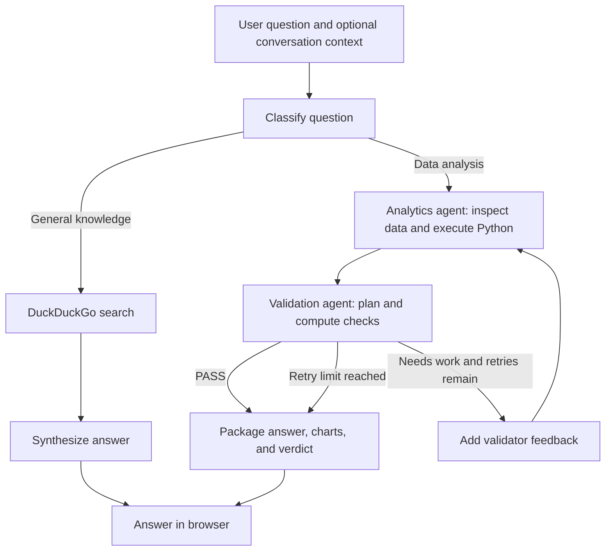

# Agentic Analytics

A conversational data analysis application that combines an iterative analytics agent with a separate validation agent. Ask a question in plain language, let the system inspect CSV data and run Python analysis, and review the answer alongside charts and a validation verdict.

Built with **LangGraph, FastAPI**. General knowledge questions take a separate web-search route. The included example data covers financial statements and metrics from 2014–2018.

## Features

- **Automatic question routing:** classifies questions as data analysis or general knowledge, then routes them to the analytics workflow or DuckDuckGo search.
- **Iterative analysis:** generates and executes Python code, retaining variables and DataFrames across iterations within an analysis run.
- **Separate validation:** generates a structured verification plan and executes pandas operators to compare independently computed results with the analysis output.
- **Feedback-driven retries:** sends the validator's suggestions back to the analytics agent when a result needs further work.
- **Multi-dataset analysis:** passes all discovered CSV files to the workflow, with operators for filtering, aggregation, ranking, joins, and unions.
- **Interactive charts:** generates Plotly figures and renders them alongside answers in the browser.
- **Conversation context:** stores recent turns in memory and adds recent context to questions recognized as follow-ups.
- **Progress events:** uses Server-Sent Events (SSE) to deliver status messages and the final result to the frontend.

## How it works



The analytics agent works in a persistent Python namespace for each run. The validator uses a separate structured plan and operator executor rather than reusing the analytics agent's generated code. It receives a summary of the analysis output for comparison, so it is a separate computation path rather than a blind evaluation.

Validation can return `PASS`, `INCOMPLETE`, `SUSPICIOUS`, or `RETRY`. When the retry budget is exhausted, the system returns the current answer with its latest verdict; a returned answer does not necessarily mean validation passed. General knowledge answers do not go through the data validator.

## Quick start

### 1. Clone and install

Use Python 3.10 or later. Run the following commands in a terminal on macOS or Linux:

```bash
git clone https://github.com/yutongwang01/agentic-analytics.git
cd agentic-analytics

python3 -m venv .venv
source .venv/bin/activate

python -m pip install --upgrade pip
python -m pip install openai pandas numpy langgraph typing-extensions fastapi uvicorn pydantic plotly python-dotenv langchain-community langchain-openai duckduckgo-search
```

Dependencies are currently installed directly; the repository does not include a pinned dependency file.

### 2. Configure the model

Create a `.env` file in the repository root:

```dotenv
OPENAI_API_KEY=your_openai_api_key
MODEL_NAME=model_name
```

Replace the placeholder with your own API key. `MODEL_NAME` is optional. The backend reads these settings from the root `.env` file; keep that file local and do not commit it.

Model calls require network access and may incur API charges. Web search and frontend libraries loaded from CDNs also require an internet connection.

### 3. Prepare the data

The sample CSV files are bundled inside `datasets/archive.zip`. Extract them before starting the backend:

```bash
python -m zipfile -e datasets/archive.zip datasets
```

After extraction, the dataset directory should contain:

```text
datasets/
├── archive.zip
├── 2014_Financial_Data.csv
├── 2015_Financial_Data.csv
├── 2016_Financial_Data.csv
├── 2017_Financial_Data.csv
└── 2018_Financial_Data.csv
```

The backend discovers `.csv` files directly inside `datasets/` at startup and passes all of them to the analytics workflow. It does not read the ZIP archive or scan nested directories. Restart the backend after adding or replacing datasets.

You can supply your own CSV files in this directory. Some column-reference and unit hints are tailored to the included financial data, so other schemas may require adjustments in `analytics_agent.py`.

### 4. Start the backend

From the repository root, with the virtual environment active:

```bash
python -m uvicorn backend.main:app --reload --host 127.0.0.1 --port 8000
```

Check the [health endpoint](http://127.0.0.1:8000/health) to confirm the server is running and the CSV files were discovered. FastAPI's interactive API documentation is available at [http://127.0.0.1:8000/docs](http://127.0.0.1:8000/docs).

### 5. Open the frontend

In a second terminal, run this command from the repository root:

```bash
python3 -m http.server 8080 --bind 127.0.0.1 --directory frontend
```

Open [http://127.0.0.1:8080](http://127.0.0.1:8080) in your browser. The frontend connects to `http://127.0.0.1:8000`, which is configured in `frontend/index.html`. If you change the backend address, update that value as well.

The backend and frontend are served separately. Use the **Reset** button to clear the shared conversation history.

## Project structure

```text
agentic-analytics/
├── orchestrator.py       # LangGraph routing and analytics–validation retry loop
├── analytics_agent.py    # Iterative Python analysis and Plotly generation
├── validator_agent.py    # Verification planning, execution, and verdicts
├── executor.py           # Structured plan executor and execution traces
├── operators.py          # pandas operators and multi-table registry
├── nodes.py              # Session memory, configuration loader, and helper routines
├── backend/
│   └── main.py           # FastAPI endpoints and SSE responses
├── frontend/
│   └── index.html        # Chat interface, charts, and validation display
├── datasets/
│   └── archive.zip       # Five annual financial CSV files
└── README.md
```

## API

| Method | Endpoint | Purpose |
| --- | --- | --- |
| `POST` | `/chat` | Submit `{"question": "..."}` and receive an SSE response. |
| `GET` | `/history` | Read conversation turns stored in memory. |
| `POST` | `/reset` | Clear the shared conversation memory. |
| `GET` | `/datasets` | List CSV files discovered at startup. |
| `GET` | `/health` | Inspect server status, model setting, datasets, and memory count. |

The `/chat` stream emits `progress`, `result`, and `error` events. The final result includes the answer, question type, generated plots, validator details, retry count, iteration count, and a history snapshot. It streams status events and the completed answer rather than individual answer tokens.

## Configuration and execution limits

| Setting | Default | Location |
| --- | --- | --- |
| API key | Required | Root `.env`: `OPENAI_API_KEY` |
| Model | `gpt-4.1-mini` | Root `.env`: `MODEL_NAME` |
| Analysis iterations per run | 8 | `analytics_agent.py`: `MAX_ITERATIONS` |
| Additional code execution attempts after an error | 2 | `analytics_agent.py`: `MAX_RETRIES_ON_ERROR` |
| Additional analytics–validation cycles | 3 | `orchestrator.py`: `MAX_RETRIES` |
| Stored conversation turns | 10 | `backend/main.py`: `SessionMemory(max_turns=10)` |
| Frontend backend URL | `http://127.0.0.1:8000` | `frontend/index.html`: `API` |

Analysis iterations and validation retries are separate limits. With three validation retries, a request can run up to four analytics–validation cycles. Each analytics run starts a new execution namespace. Conversation follow-ups receive text context from the last two turns when detected; they do not inherit Python variables from earlier requests.

## Current limitations

- **Local, single-user design.** Conversation memory and the table registry are shared within the server process. There is no authentication or per-user session isolation. Keep the application on localhost; concurrent users or overlapping requests are not isolated.
- **In-memory history.** Restarting the backend clears conversation history. Follow-up detection uses keyword matching and may miss context-dependent questions.
- **Direct code execution.** Generated analysis and plotting code runs in the backend Python process without a sandbox. Use a trusted local environment and datasets appropriate for this workflow.
- **Model-assisted checks.** The validator also relies on model-generated plans and verdicts. A `PASS` is a useful check, not a guarantee of correctness; inspect important results independently.
- **External data processing.** Dataset schemas, sample rows, intermediate results, and question context may be included in model requests. General knowledge questions are sent to web search.
- **Financial-data assumptions.** Some column mappings and unit guidance are specific to the bundled data. Support for new CSV schemas should be checked before relying on results.
